# Detailed naming algorithm flowcharts (v57)

These diagrams follow the 2D Greek naming path in
[mulermoc-nom-core-57.js](../js/mulermoc-nom-core-57.js). They describe what
the code does, not a complete implementation of IUPAC rules. The
[overview](NAMING-FLOWCHART-57.md) shows how the stages fit together. English
naming and the separate 3D analysis path are outside this document.

## 1. Analyse the structure

`fAnalyseStructure` reads the JSME molecule. Connectivity and valence below
exclude bonds to explicit hydrogen; `bondList` still records every bond.

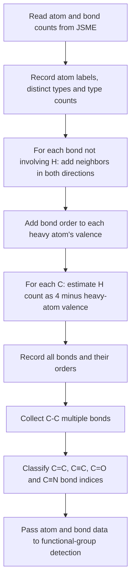

## 2. Detect functional groups

`fDetectMolType` uses heavy-atom connectivity, valence and bond order. It
first classifies atoms individually, then combines related oxygen
classifications. Detection does not imply that naming supports the result.
Explicit H has no dedicated detection case.

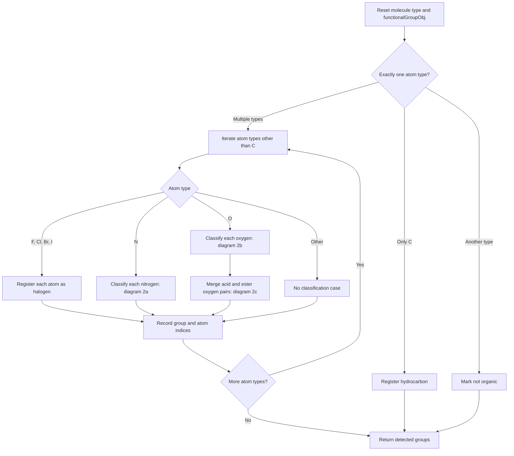

### 2a. Nitrogen

For terminal N, the valence is the sum of bond orders to heavy atoms. For
non-terminal N, bond counts are taken from the full bond list.

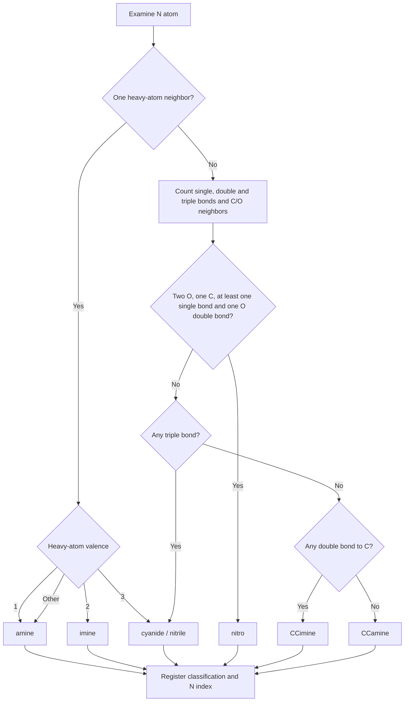

### 2b. Oxygen

The aldehyde/ketone decision uses the neighboring atom's heavy-atom valence
and connectivity. For ordinary carbonyls that neighbor is carbon.

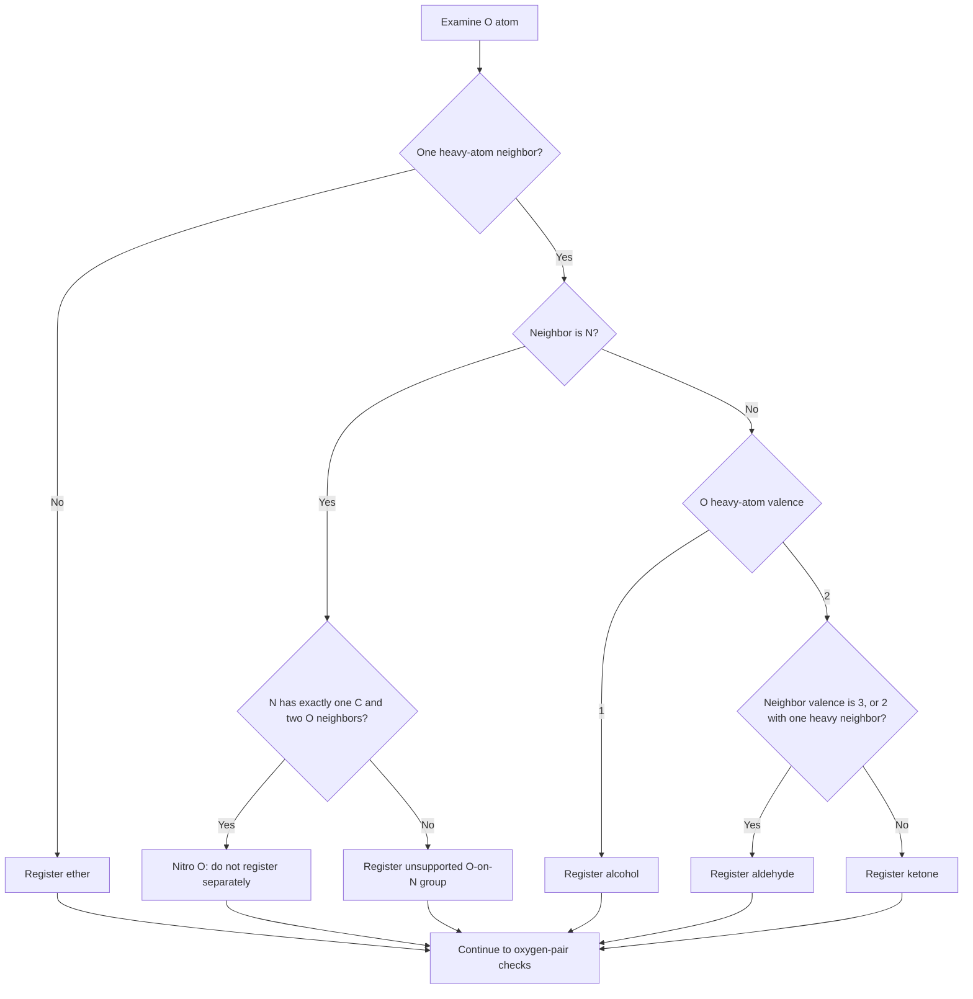

### 2c. Reclassify oxygen pairs

The pairs are stored as O indices in `functionalGroupObj`. Matched preliminary
groups are removed; empty buckets are deleted.

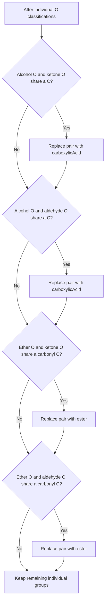

The second acid and ester checks also catch methanoic acid and formate esters,
whose carbonyl can initially be classified as aldehyde.

## 3. Check naming scope

`fGuessName` initializes the naming tables if needed. If no group was
detected, it inserts a hydrocarbon entry before these checks.

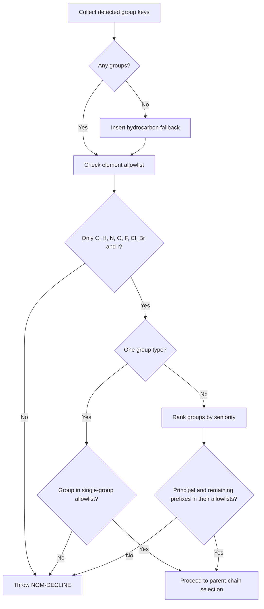

Single-group naming allows hydrocarbon, halogen, nitro, alcohol, ketone,
ether, aldehyde, cyanide, carboxylic acid and ester. For multiple groups, the
principal must be carboxylic acid, cyanide, aldehyde, ketone or alcohol.
Amine may be a prefix, but an amine alone is not in the single-group
allowlist. Other guards may still decline a structure later.

## 4. Select the parent chain

`fCalcMainChain` normally runs inside `fGuessName`; the chain stepper can ask
`fGuessName(true)` to retain its already-selected chain instead.

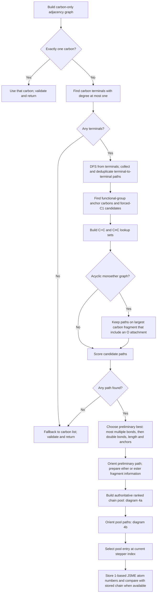

The no-terminal and no-path cases are fallbacks, not support for cyclic
nomenclature. The preliminary path also supplies ether/ester fragment
information; the ranked pool determines the displayed chain when nonempty.

### 4a. Rank the chain pool

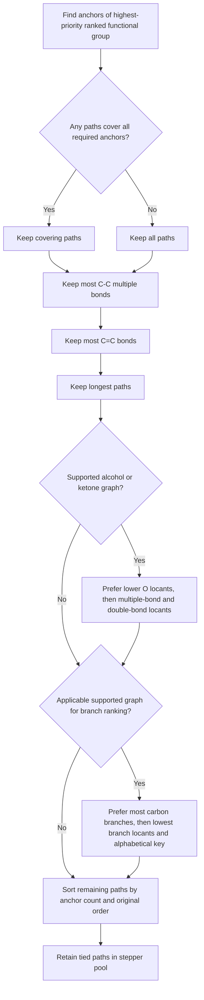

### 4b. Orient a path

Each locant comparison considers the path in both directions. Equal-priority
terminal groups at both ends suppress the forced-C1 choice.

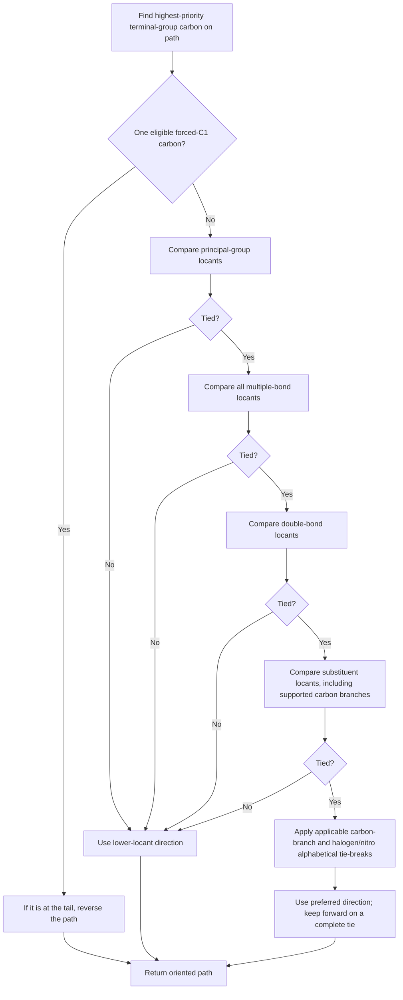

Forced-C1 priority is carboxylic acid, ester, cyanide, then aldehyde.

## 5. Choose the active chain and build name components

After chain calculation, stored-chain mode can replace the selected 2D chain
when matching data exists. The function also attempts to match the numbered
2D chain to the 3D chain.

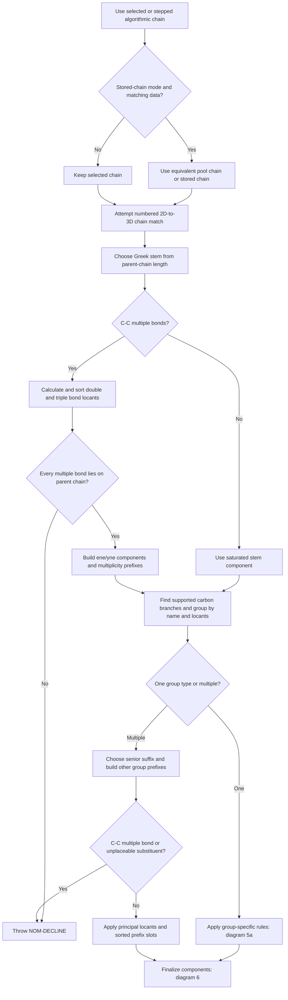

### 5a. Single functional-group naming

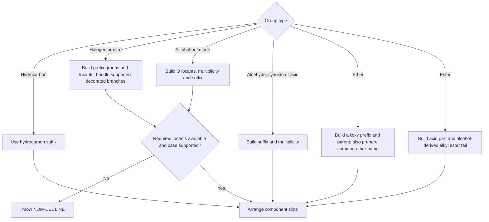

Some locants are omitted for short chains under the code's school-naming
conventions. Branch and decorated-branch support is restricted to the graph
shapes checked by the corresponding helpers.

## 6. Assemble the output

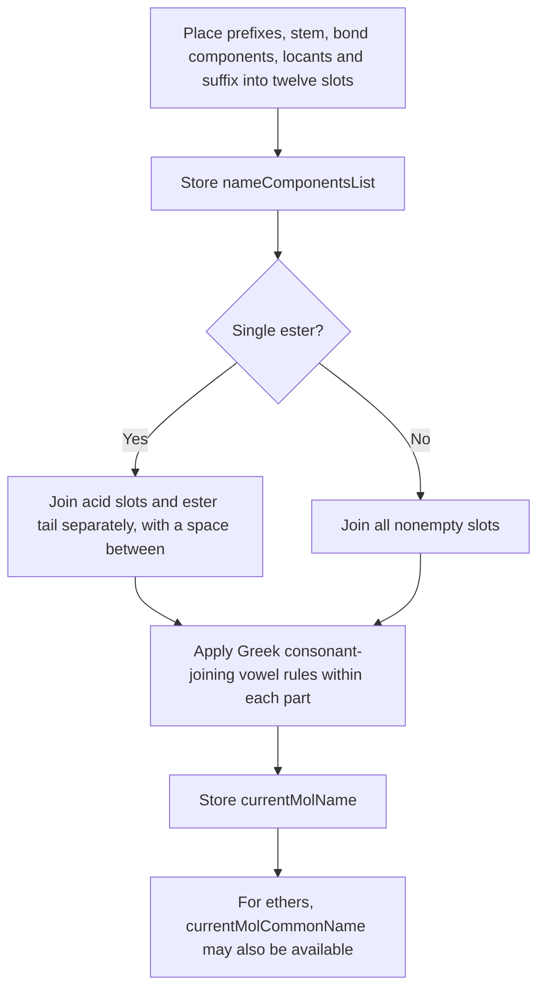

The core throws `NOM-DECLINE` for several unsupported elements, groups and
locant situations. Callers decide how to handle that error. Detection and
fallback paths should therefore not be interpreted as a guarantee that every
structure is named correctly.
